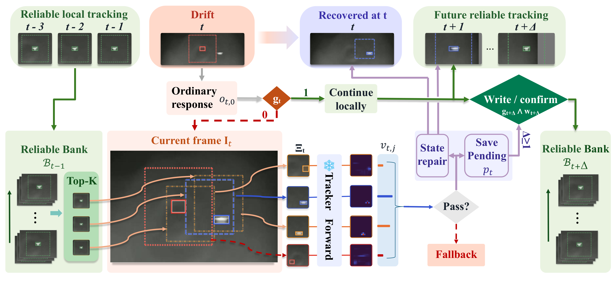

# ReSeT

**ReSeT: Reliable Search-State Recovery for Infrared Anti-UAV Tracking**  
Jiahong Su, Chaoqun Hong, Kai Zhang, and Kejie Zhang

ReSeT manages the search state of a frozen local tracker. Ordinary observation
adaptation regulates routine tracking, while verified historical-origin queries
redirect the search when alternative evidence is needed.

**Ordinary observation path (OA):** search extent / Hann control / proposal re-ranking.



## Code

`src/` contains the ReSeT implementation, five tracker adapters and their upstream
compatibility patches. `predictions/` contains the main Base/ReSeT test outputs for
AntiUAV410 and CST-AntiUAV. Each box file stores one `x, y, width, height` row per
frame, including initialization. CST score files store native response scores.

## Inference

Prepare the ORTrack CUDA environment using the upstream installation instructions.
The reference environment uses Python 3.8 and PyTorch 1.8.1+cu111. Obtain
`ORTrack_ep0300.pth.tar` from the [ORTrack project](https://github.com/wuyou3474/ORTrack).
From this repository root:

```bash
git clone https://github.com/wuyou3474/ORTrack.git ../ORTrack
git -C ../ORTrack checkout ede2ed47f566b07f70fd5d81630597e05a54e96f
python install.py --tracker ortrack --repo ../ORTrack
python track.py --repo ../ORTrack --data ANTIUAV410_ROOT --checkpoint ORTrack_ep0300.pth.tar --output outputs/reset
```

The dataset root contains `test/SEQUENCE/IR_label.json` and frame images.
Add `--sequence SEQUENCE_NAME` to process one sequence.

The additional interfaces use the repositories and pinned revisions in
`src/adapters.json`. Install each upstream environment and checkpoint, then use
`install.py --tracker ADAPTER --repo PATH_TO_REPOSITORY`. Their upstream
`tracking/test.py` accepts the following tracker/parameter pairs:

| Adapter | Tracker / parameter |
|---|---|
| `sglatrack` | `sglatrack_reset sglatrack_reset` |
| `compresstracker` | `compresstracker_reset compresstracker_reset` |
| `ostrack` | `ostrack_reset ostrack_reset` |
| `romtrack` | `ROMTrack_reset ROMTrack_reset` |

## Evaluation

Obtain annotations from [AntiUAV410](https://github.com/HwangBo94/Anti-UAV410) or
[CST-AntiUAV](https://github.com/PCwenyue/CST-Anti-UAV). Saved-prediction evaluation
requires annotations, but no images or model weights.

```bash
pip install -r requirements.txt
python evaluate.py --dataset AntiUAV410 --data ANTIUAV410_ROOT
python evaluate.py --dataset CST-AntiUAV --data CST_ROOT
```

Metrics are printed to the terminal. Add `--output outputs/metrics.csv` to save
them. AntiUAV410 uses its reference evaluator; CST uses the fixed per-interface
presence thresholds shared by each Base/ReSeT pair.

## Acknowledgments

The adapters build on [ORTrack](https://github.com/wuyou3474/ORTrack),
[SGLATrack](https://github.com/GXNU-ZhongLab/SGLATrack),
[CompressTracker](https://github.com/LingyiHongfd/CompressTracker),
[OSTrack](https://github.com/botaoye/OSTrack), and
[ROMTrack](https://github.com/dawnyc/ROMTrack).
`src/antiuav410_evaluator.py` is the archived AntiUAV410 evaluator.
Upstream software, datasets and checkpoints retain their respective licenses;
the ReSeT MIT license does not replace those terms.
